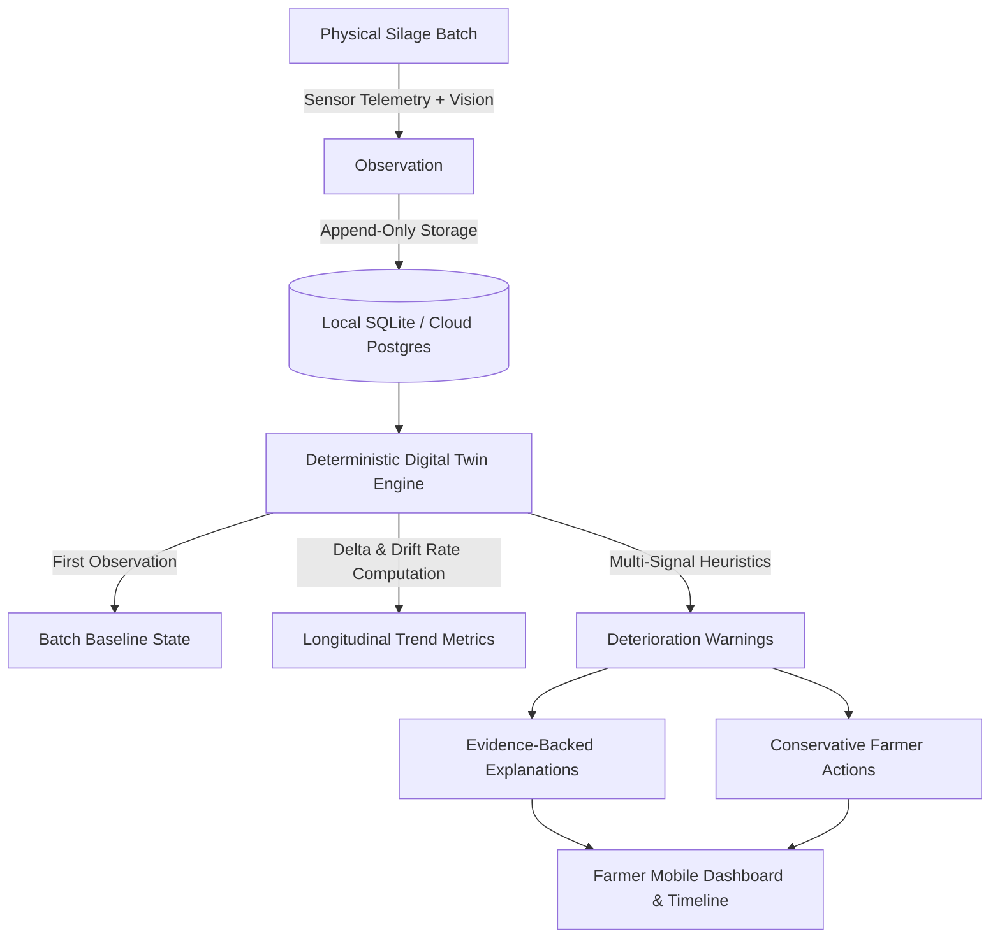
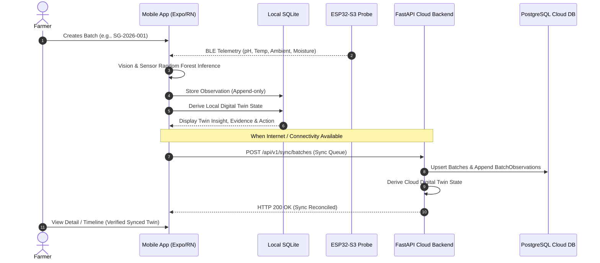
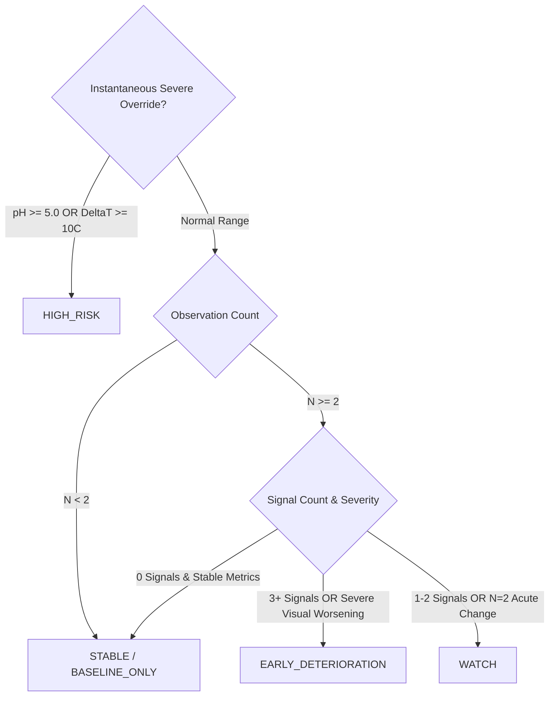

# SilageGuard AI — Digital Twin Architecture Specification

## 1. Executive Summary & Vision

The SilageGuard AI Digital Twin is a **deterministic, explainable, offline-first digital representation of a physical silage batch's lifecycle, fermentation trajectory, and biological deterioration status**.

Rather than treating silage monitoring as disconnected single-point screenings, the Digital Twin tracks the biological evolution of a designated batch across time by comparing current observations against an established physical baseline, computing longitudinal parameter drift rates, detecting multi-sensor deterioration signals, and providing evidence-backed, conservative agricultural guidance to dairy and silage farmers.

---

## 2. Core Architectural Principles

1. **Observations are the Single Source of Truth**:
   The Digital Twin state is **derived** from the append-only chronological history of valid observations for a batch. The twin is never arbitrarily mutated in isolation. Re-running the engine across a batch's observations reconstructs the identical twin state idempotently.
2. **Deterministic & Explainable (Zero Black-Box Temporal ML)**:
   The Digital Twin intentionally avoids opaque temporal neural networks (LSTMs, GRUs, Transformers) for trend detection. All rates of change ($\Delta\text{pH}$, $\Delta\text{temp}$, $\Delta\Delta T$, $\Delta\text{MSSI}$) and deterioration levels are calculated with simple, auditable, high-performance mathematics.
3. **The Single Observation ($N=1$) Invariant**:
   A single observation can only establish the **current screening verdict** and the **batch baseline**. It is mathematically impossible to establish a longitudinal deterioration trend from a single data point. The system requires $N \ge 2$ observations for change detection and $N \ge 3$ observations before asserting a persistent trend.
4. **Current Safety Rules Remain Authoritative**:
   Instantaneous deterministic safety overrides (e.g., severe aerobic heating with $\Delta T \ge 10.0^\circ\text{C}$ or critical pH $\ge 5.0$) remain authoritative for immediate screening triage (`HIGH_RISK`). The Digital Twin answers the complementary question: *"Is this batch changing negatively over time?"*
5. **100% Frontend-Backend Parity**:
   The JavaScript engine (`frontend/services/ai/digitalTwinEngine.js`) and Python backend engine (`backend/app/services/digital_twin_engine.py`) utilize identical formulas, signal rules, threshold values, warning states, and recommendation strings. The farmer receives identical insights whether completely offline in a rural trench bunker or synced with the cloud.

---

## 3. Data Flow & System Topology

---

## 4. Digital Twin Data Model

The Digital Twin state structure is defined uniformly across TypeScript/JavaScript and Python/Pydantic:

| Field Name | Type | Description |
| :--- | :--- | :--- |
| `batch_id` | `string` | Physical batch identifier (e.g. `SG-2026-001`) |
| `baseline_observation_id` | `string` | Primary ID of the earliest valid observation |
| `latest_observation_id` | `string` | Primary ID of the most recent valid observation |
| `observation_count` | `number` | Total count of valid observations in batch timeline |
| `first_observed_at` | `ISO 8601 string` | Baseline timestamp |
| `last_observed_at` | `ISO 8601 string` | Most recent observation timestamp |
| `current_status` | `string` | Current screening verdict (`SAFE`, `CAUTION`, `HIGH_RISK`) |
| `current_mssi` | `number` | Current Multi-modal Silage Safety Index (0–100) |
| `baseline_mssi` | `number` | Baseline Multi-modal Silage Safety Index (0–100) |
| `mssi_change` | `number` | Absolute change ($\text{current} - \text{baseline}$) |
| `mssi_change_percent` | `number` | Relative change percentage |
| `ph_baseline` | `number` | Earliest valid core pH |
| `ph_current` | `number` | Most recent core pH |
| `ph_change` | `number` | Absolute pH drift ($\text{current} - \text{baseline}$) |
| `temperature_baseline` | `number` | Earliest core temperature ($^\circ\text{C}$) |
| `temperature_current` | `number` | Most recent core temperature ($^\circ\text{C}$) |
| `temperature_change` | `number` | Core temperature change ($^\circ\text{C}$) |
| `delta_temperature_baseline`| `number` | Baseline $\Delta T = T_{\text{core}} - T_{\text{ambient}}$ |
| `delta_temperature_current` | `number` | Latest $\Delta T = T_{\text{core}} - T_{\text{ambient}}$ |
| `moisture_baseline` | `number` | Baseline estimated moisture percentage (%) |
| `moisture_current` | `number` | Current estimated moisture percentage (%) |
| `visual_baseline` | `string` | Initial visual condition class |
| `visual_current` | `string` | Latest visual condition class |
| `trend_direction` | `string` | `IMPROVING`, `STABLE`, `DETERIORATING`, or `INSUFFICIENT_DATA` |
| `deterioration_detected` | `boolean` | Flag indicating whether any negative trajectory was triggered |
| `warning_level` | `string` | `STABLE`, `WATCH`, `EARLY_DETERIORATION`, or `HIGH_RISK` |
| `warning_reasons` | `string[]` | Plain-language, evidence-backed list of deterioration triggers |
| `recommended_action` | `string` | Conservative farmer guidance statement |
| `last_updated` | `ISO 8601 string` | Timestamp of Twin state generation |

---

## 5. Mathematical Trend & Deterioration Engine

### 5.1 Elapsed Time & Rate Normalization
To prevent false drift calculations caused by test bursts or same-minute repeated readings:
$$\Delta t = \frac{t_{\text{latest}} - t_{\text{previous}}}{86400 \text{ seconds}}$$
Rates of change per day are computed **only** when $\Delta t \ge 0.05 \text{ days}$ (1.2 hours):
$$\text{Rate}_{\text{parameter}} = \frac{X_{\text{latest}} - X_{\text{previous}}}{\Delta t}$$
If $\Delta t < 0.05 \text{ days}$, daily rate calculation is safely clamped to `null` to avoid mathematical instability.

### 5.2 Deterioration Signal Heuristics
The engine monitors five longitudinal signals against established baseline and previous observations:

1. **Signal 1 — MSSI Index Decline**:
   - Significant drop from baseline: $\text{MSSI}_{\text{current}} \le \text{MSSI}_{\text{baseline}} - 8.0$
   - Acute drop from previous: $\text{MSSI}_{\text{current}} \le \text{MSSI}_{\text{prev}} - 5.0$
2. **Signal 2 — pH Elevation (Secondary Fermentation / Clostridial Risk)**:
   - Elevation from baseline: $\text{pH}_{\text{current}} \ge \text{pH}_{\text{baseline}} + 0.25$
   - Acute rise: $\text{pH}_{\text{current}} \ge \text{pH}_{\text{prev}} + 0.20$
3. **Signal 3 — Core Thermal Elevation (Aerobic Instability)**:
   - Thermal rise from baseline: $T_{\text{core, current}} \ge T_{\text{core, baseline}} + 2.5^\circ\text{C}$
   - Acute thermal rise: $T_{\text{core, current}} \ge T_{\text{core, prev}} + 2.0^\circ\text{C}$
4. **Signal 4 — Differential Thermal Rise ($\Delta T$)**:
   - Rise above ambient: $\Delta T_{\text{current}} \ge \Delta T_{\text{baseline}} + 2.5^\circ\text{C}$
   - Acute rise: $\Delta T_{\text{current}} \ge \Delta T_{\text{prev}} + 2.0^\circ\text{C}$
5. **Signal 5 — Visual Condition Degradation**:
   - Visual classes are strictly ranked: `Healthy (0)` $\to$ `Abnormal Appearance (1)` $\to$ `Spoilage / Mould (2)`.
   - Any monotonic increase in visual rank triggers the visual deterioration signal.

### 5.3 Warning Level Matrix

| Warning Level | Criteria | Recommended Farmer Action |
| :--- | :--- | :--- |
| `STABLE` | 0 deterioration signals triggered; MSSI stable within $\pm 4$ points. | *Continue routine monitoring according to your normal feed management schedule.* |
| `WATCH` | 1 or 2 deterioration signals active (e.g. minor pH uptick or solitary temperature rise). | *Monitor this batch again within 24–48 hours and inspect the bunker face for visible signs of air ingress or packing voids.* |
| `EARLY_DETERIORATION` | $\ge 3$ simultaneous signals (e.g. $\text{MSSI}\downarrow + \text{pH}\uparrow + \text{Temp}\uparrow$) OR visual degradation to mould. | *Inspect the silage face immediately, review feed-out rate, and discard any visibly spoiled layers before feeding.* |
| `HIGH_RISK` | Critical instantaneous safety override (pH $\ge 5.0$, $\Delta T \ge 10^\circ\text{C}$, or MSSI $< 45$). | *Follow farm biosecurity safety procedures. Do not feed suspected spoiled silage to lactating or pregnant livestock. Seek laboratory testing.* |

---

## 6. Offline Storage & Sync Reconciliation

### 6.1 Local SQLite Storage
- Observations are stored in the local SQLite table `observations`.
- When `localDb.getDigitalTwin(batchId)` is invoked, observations for that batch are queried in ascending chronological order (`ORDER BY scanned_at ASC`).
- `digitalTwinEngine.computeDigitalTwin(observations)` derives the state on-the-fly and returns the comprehensive model in less than 2 milliseconds.
- This guarantees zero UI latency and complete offline autonomy in rural areas without mobile cellular coverage.

### 6.2 Cloud Reconciliation
- When the phone regains internet access, the sync queue flushes stored observations via `POST /api/v1/sync/batches`.
- The backend `sync_service.py` records new observations into `BatchObservation` while safely deduplicating previously synced scans.
- The cloud endpoint `GET /api/v1/analytics/twin/{batch_id}` derives the identical Digital Twin state using `digital_twin_engine.py`.

---

## 7. Scientific Honesty & Boundaries

1. **Screening vs. Laboratory Diagnostics**: The SilageGuard Digital Twin is an engineering screening and early warning tool. It does not provide certified microbiological, volatile fatty acid (VFA), or wet-chemistry laboratory analysis.
2. **No Unsubstantiated Mycotoxin or Clostridial Claims**: The system flags parameter combinations consistent with aerobic exposure or clostridial risk; it never claims direct mycotoxin quantification.
3. **Conservative Farmer Language**: The system never prescribes dangerous feed mixing ratios or asserts deterministic shelf-life expiry dates without laboratory validation.
